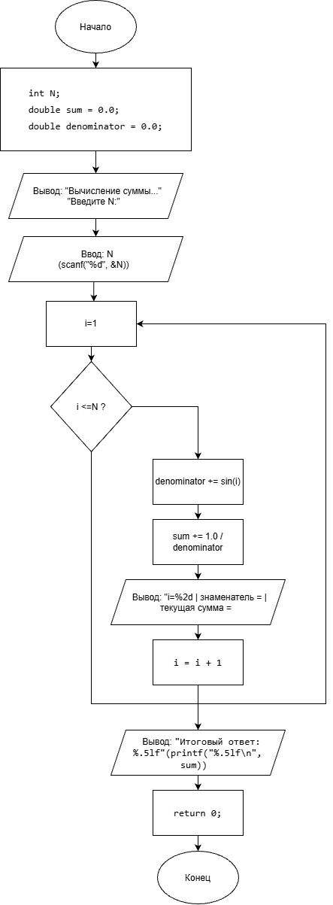

# Лабораторная работа N8
## Домашнее задание
Вычислите с использованием цикла for значение для заданного N:
1/sin 1 + 1/(sin 1 + sin 2) +... + 1/(sin 1 + sin 2 +... + sin N)
### Алгоритм и блок-схема
### Алгоритм
1. Начало
2. Объявление переменных
3. Составление условия и программы
4. Конец
### Блок-схема

## Реализация программы
```c #define _CRT_SECURE_NO_WARNINGS
#include <stdio.h>
#include <math.h>
#include <locale.h>

int task0(void);
int task1(void);
int task1A(void);
int task2(void);
int task3(void);

int main(void) {
	setlocale(LC_CTYPE, "RUS");
	task0();
	task1();
	task1A();
	task2();
	task3();
	return 0;
}

int task0(void) {
	int n;
	char k;
	printf("введите количество: ");
	scanf("%d", &n);
	printf("введите символ: ");
	scanf("%c", &k);
	for (int start = 0; start < n; start++) printf("%c", k);
	puts("");
	return 0;
}

int task1(void) {
	int n, m;
	int s = 0;
	int k = 0;
	puts("Введите n и m через пробел");
	scanf("%d %d", &n, &m);
	for (int i = m; i >= n; i--) {
		s += i;
		k++;
	}
	printf("Выполнено %d раз\n", k);
	printf("Результат %d\n", s);
	return 0;
}

int task1A(void) {
	int n, m;
	double res = 0;
	puts("введите степень");
	scanf("%d", &n);
	puts("введите заданное число m");
	scanf("%d", &m);
	for (int i = 0; i <= n; i++) {
		if ((m < ((pow(2., (double)i))))) {
			res = pow(2., (double)i);
			break;
		}
		printf("2^%d = %.0lf\n", i, pow(2., (double)i));
	}
	printf("Результат: %.1lfK\n", res / 1024.);
	return 0;
}

int task2(void) {
	double t;
	puts("y = | lg x | - (x - 2)^2");
	puts("введите шаг");
	scanf("%lf", &t);
	puts("-----------------");
	for (double i = 2.; i <= 4.1; i += t) {
		printf("| %5.1lf | %5.1lf |\n", i, fabs(log10(i))-pow((i-2.),2.));
	}
	return 0;
}
int task3(void) {
	int N;
    double sum = 0.0;
    double denominator = 0.0; // Сумма синусов 
    puts("Вычисление суммы: 1/sin(1) + 1/(sin(1)+sin(2)) + ... + 1/(sin(1)+...+sin(N))");
    puts("Введите N:");
    scanf("%d", &N);
    puts("---------------------");

    for (int i = 1; i <= N; i++) {
        // Накапливаем знаменатель: sin(1) + sin(2) + ... + sin(i)
        denominator += sin(i); 
        
        // Добавляем к общей сумме текущую дробь
        sum += 1.0 / denominator;
       
        printf("i = %2d | Знаменатель = %6.3lf | Текущая сумма = %6.3lf\n", 
               i, denominator, sum);
    }

    printf("-----------------------\n");
    printf("Итоговый ответ: %.5lf\n", sum);

    return 0;
}
